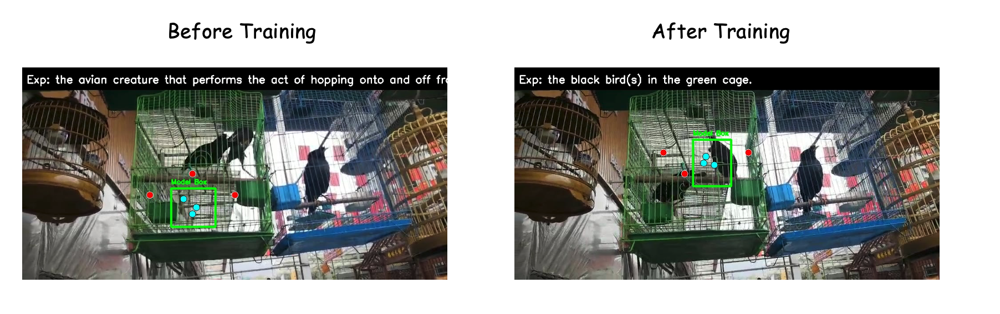
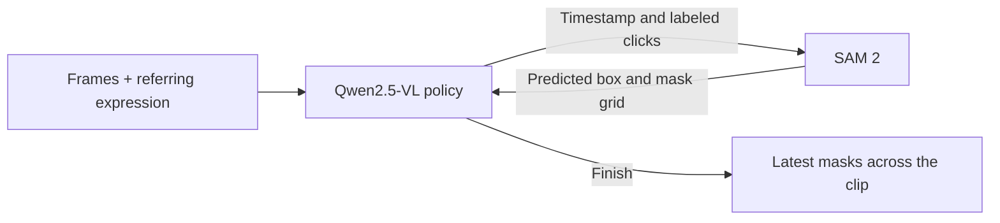

<h1 align="center">NeSeg: Multi-Turn Video Object Segmentation<br>with Positive and Negative Point Prompts</h1>

<p align="center">
  <a href="#how-neseg-works">Method</a> ·
  <a href="#training-the-policy">Training strategy</a> ·
  <a href="#reward-design">Rewards</a> ·
  <a href="#getting-started">Getting started</a> ·
  <a href="#inference">Inference</a>
</p>

Given a video and a description such as **“the black bird in the green cage,”** NeSeg learns where to click and when to correct a mask. Qwen2.5-VL chooses a frame, places positive points on the bird and uses negative points to exclude nearby regions. A frozen SAM 2 turns those clicks into masks and tracks the target through the sampled frames.



*Point placement in a crowded scene. In the right panel, cyan points identify the requested bird. Red points tell SAM 2 which nearby regions to exclude.*

## How NeSeg works



At each turn the policy sees a bounding box and a **12 × 12 foreground grid** from SAM 2 at the clicked time. If the mask includes part of a neighboring bird, the policy can add a negative click there. If a wing is missing, it can add a positive click on the wing. Clicks accumulate in the same SAM 2 session, including when the policy moves to another frame. The episode returns the latest masks when the policy finishes or reaches the default limit of three calls.

## Training the policy

| Stage | What the policy learns | How the signal is built |
| --- | --- | --- |
| Data construction | Which object an expression refers to and when it is visible | Pair ReVOS, RVOS and Ref-SAV expressions with their masks. Sample across the clip and include frames where the target is visible. Ref-SAV supplies expressions for SA-V masklets. |
| Supervised fine-tuning | Choose a timestamp, place both kinds of clicks and recognize the finish action | Sample positive points inside the annotated target. Mine nearby background patches whose DINOv2 features resemble the foreground. Run SAM 2 to produce the observations used in demonstration conversations. |
| GRPO | Decide whether another click is worth making | EasyR1, built on veRL, samples independent trajectories for the same expression. Each starts with a fresh SAM 2 session. The final mask quality and the number of tool calls both contribute to the return. |

The original project data build produced **30k+ training examples**. The preparation commands below report counts for each new export. Both SFT and GRPO apply loss to the policy's own action tokens. SAM 2 observations are visible as context.

## Reward design

Half the default reward comes from the **final video mask**. Point-level terms give the policy feedback about individual clicks, including cases where SAM 2 recovers a good mask from an imprecise prompt.

| Signal | Weight | How it is scored |
| --- | ---: | --- |
| Final mask IoU | 50% | Sum intersection and union over the sampled frames, then divide. False foreground on target-absent frames counts against the score. |
| Positive hit | 10% | Fraction of positive clicks inside the target on the selected frame. |
| Positive distance | 10% | Credit decays with distance to the nearest sampled foreground reference point. |
| Negative hit | 10% | A negative click earns +1 outside the target and −1 inside it. |
| Negative DINOv2 similarity | 10% | A correct negative click earns more when its patch resembles the foreground. A click on the target receives zero similarity credit. |
| Action format | 5% | The episode completes with valid JSON actions and at least one executed segmentation call. |
| Tool efficiency | 5% | Final mask IoU divided by the number of executed calls. |

<details>
<summary>Scoring details and edge cases</summary>

Points use coordinates from 0 to 1000 on each axis. For positive distance, the score is `exp(-d / s)`, where `d` is measured in pixels and `s` is 10% of the frame diagonal, with a one-pixel minimum. DINOv2 uses the maximum cosine similarity to the sampled foreground references, clipped to [0, 1]. Point scores are averaged within each call and then across calls.

A malformed action or a finish before the first tool call earns zero for the episode. A call on a frame with no visible target earns zero point credit. [Reward implementation](neseg/reward.py)

</details>

## Getting started

Run the following commands from the repository root in a Linux CUDA environment. The bundled EasyR1 version uses the upstream image `hiyouga/verl:ngc-th2.8.0-cu12.9-vllm0.11.0`. [EasyR1 upstream revision](https://github.com/hiyouga/EasyR1/tree/3f527bd266f964f33c6cd6ec83ac85a6a9e5bf37)

### Install the dependencies

```bash
python -m pip install -e ./site-packages/easyr1 -r requirements-neseg.txt
python -m pip install --no-build-isolation 'git+https://github.com/facebookresearch/sam2.git@2b90b9f5ceec907a1c18123530e92e794ad901a4'

export DATA_ROOT=/absolute/path/to/Sa2VA-Training
export SAM2_CHECKPOINT=/absolute/path/to/sam2.1_hiera_tiny.pt
```

The default SAM 2 config matches the Tiny checkpoint linked below. Set `SAM2_CONFIG` for another checkpoint. The predictor runs on CPU by default. Set `SAM2_DEVICE=cuda` if each rollout GPU has enough memory for both models. [Download SAM 2.1 Tiny](https://dl.fbaipublicfiles.com/segment_anything_2/092824/sam2.1_hiera_tiny.pt)

### Prepare the data

<details>
<summary>Expected dataset layout and frame rates</summary>

| Source | Files under <code>$DATA_ROOT/video_datas/</code> |
| --- | --- |
| ReVOS | `revos/meta_expressions_train_.json`, `revos/mask_dict.json`, and frame directories named by video ID |
| RVOS | `rvos/meta_expressions/train/meta_expressions.json`, `rvos/mask_dict.pkl`, and `rvos/train/JPEGImages/<video>/` |
| Ref-SAV | `Ref-SAV.json` and `sam_v_full/` containing the referenced videos and masklet annotations |

Ref-SAV uses every fourth frame of the 24 fps source video to align with the 6 fps masks. Selected JPEGs are cached in `video_datas/.neseg_frames/`. ReVOS and RVOS default to 5 fps. Set `--revos_fps` or `--rvos_fps` to match your extraction. [Sa2VA data layout](https://github.com/bytedance/Sa2VA/tree/main/projects/sa2va) · [SA-V annotations](https://github.com/facebookresearch/sam2/tree/main/sav_dataset)

</details>

```bash
python -m preprocess_data.preprocess \
  --data_root "$DATA_ROOT" --datasets revos rvos ref_sav \
  --max_frames 8 --sft_tool_calls 2 --output_json runs/records.json

python -m neseg.prepare runs/records.json \
  --data-root "$DATA_ROOT" --output runs/prepared --with-feedback
```

The first command builds annotated records and caches DINOv2 features. If you already have NeSeg records with real masks, start with the second command. The export writes its SFT and GRPO files to `runs/prepared/`.

- `sft.jsonl` contains the timestamped frames, instruction, conversation history and next assistant action.
- `train.jsonl` and `val.jsonl` contain policy inputs and separate scoring labels with masks, reference points and feature paths. The split keeps each video's expressions together and reserves 5% of videos for validation by default.

### Train with SFT and GRPO

```bash
torchrun --standalone --nproc_per_node=4 -m neseg.sft \
  --data runs/prepared/sft.jsonl --data-root "$DATA_ROOT" --output runs/sft

GPUS=4 bash scripts/train_grpo.sh
```

SFT uses LoRA on Qwen2.5-VL-7B-Instruct's language attention layers. It exports the merged policy and processor to `runs/sft/policy`, where GRPO picks them up. The default GRPO batch contains eight questions with four trajectories each. Each rollout replica uses one GPU. Both the training and validation splits need at least one record, and training needs enough records for the configured batch size.

<details>
<summary>Training options and ablations</summary>

| To change | Setting |
| --- | --- |
| Use full-parameter SFT | Pass `--full-finetune` to `neseg.sft`. |
| Train SFT on clicks alone | Omit `--with-feedback` during export. |
| Run without DINOv2 | Preprocess with `--skip_features` and launch GRPO with `worker.reward.reward_function_kwargs.negative_dino_weight=0`. |
| Use another policy or data directory | Set `MODEL_PATH` or `PREPARED` before launching GRPO. |
| Change the call budget or reward weights | Append overrides such as `worker.rollout.neseg_max_calls=2` or `worker.reward.reward_function_kwargs.positive_distance_weight=0.15` to the GRPO command. |

</details>

## Inference

Pass frames in chronological order, their timestamps in seconds, and the expression to segment. The policy uses the same SAM 2 feedback loop as training and writes one binary PNG mask per input frame.

```bash
python -m neseg.infer --policy runs/sft/policy \
  --frames clip/00000.jpg clip/00005.jpg clip/00010.jpg --times 0 0.2 0.4 \
  --expression "the dog running behind the cyclist" --output runs/masks
```

For a GRPO checkpoint, export the actor to Hugging Face format and pass the exported directory to `--policy`. [EasyR1 model merger](site-packages/easyr1/scripts/model_merger.py)
